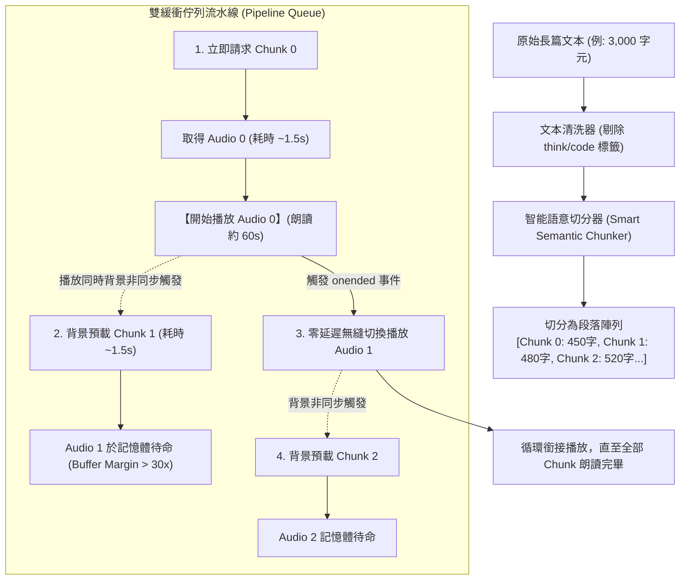

# 22. Text-to-Speech (TTS) Audio Engine & Pipeline Streaming Architecture

本文件詳細記錄 **MiniBot** 在語音輸出（Text-to-Speech, TTS）領域的雙引擎架構（Local Web Speech API + MiniMax Neural Voice）、長篇文本處理瓶頸、**智能語意切分器（Smart Semantic Chunker）**、**雙緩衝流水線預加載（Pipeline Double-Buffering）**，以及即時播放控制的人體工學設計與實作規範。

---

## 1. 架構背景與核心挑戰

MiniBot 提供兩種音訊輸出引擎，以滿足離線隱私需求與高擬真神經網絡廣播級語音體驗：
1. **Mode 1: 瀏覽器原生語音 (Local Web Speech API)**：零延遲、無需 API Key、支援離線，依賴作業系統/瀏覽器本地語音庫（`zh-HK`, `zh-CN`, `en-US`）。
2. **Mode 2: MiniMax Speech-2.8-HD (神經網絡語音 API)**：高保真廣播級擬真度、細膩的情感與語調表現、專屬聲線（如 `Cantonese_CuteGirl`、男女聲線）。

### 1.1 長文截斷問題（The Truncation Problem）
在實際使用中，大語言模型（LLM）產生的回答篇幅通常在 1,000 ~ 4,000 字元以上。當直接將整篇長文一次性發送至 MiniMax `t2a_v2` 接口時，會面臨以下硬性限制：
- **API 單次字數限制**：MiniMax 官方服務對單次合成建議在 500 ~ 1,000 字以內。超過上限時，服務端會直接截斷文本、遺漏後半段內容，或返回失敗。
- **長連線超時與首字延遲（TTFB）過高**：若一次性合成數千字，後端計算耗時高達 15 ~ 25 秒，使用者在螢幕前乾等過久容易觸發網路超時（Gateway Timeout）中斷。

---

## 2. 解決方案：雙緩衝流水線流式架構 (Pipeline Streaming & Double-Buffering)

為徹底解決長文截斷並消除段落之間的卡頓，MiniBot 採用了業界標準的 **「智能語意切分 + 雙緩衝佇列流水線」** 架構：



---

## 3. 核心設計要點與實作規範

### 3.1 智能語意斷句算法 (Smart Semantic Chunker)
單純使用 `text.slice(0, 500)` 強制截斷會切斷詞彙或使句子戛然而止，造成嚴重的聽覺突兀感。切分算法依據語言學標點符號階層遞減切分：

```typescript
// 智能語意斷句（目標約 400 ~ 550 字/段，切在標點符號處）
const splitForMiniMax = (str: string, targetLen = 450, hardMax = 650): string[] => {
  // 1. 第一優先級：依據段落換行切分
  const paragraphs = str.split(/\n+/).map((p) => p.trim()).filter(Boolean);
  const chunks: string[] = [];
  let cur = "";

  for (const p of paragraphs) {
    if ((cur + " " + p).length <= targetLen) {
      cur += (cur ? "\n" : "") + p;
    } else {
      if (cur) {
        chunks.push(cur);
        cur = "";
      }
      // 2. 第二優先級：超長段落依據句號/感嘆號/問號切分
      if (p.length > hardMax) {
        const sentenceRegex = /[^。！？!?；;\n]+[。！？!?；;\n]+|[^。！？!?；;\n]+$/g;
        const sentences = p.match(sentenceRegex) || [p];
        let sub = "";
        for (const s of sentences) {
          if ((sub + s).length <= targetLen) {
            sub += s;
          } else {
            if (sub) chunks.push(sub.trim());
            // 3. 第三優先級：超長無標點語句依據逗號/頓號切分
            if (s.length > hardMax) {
              const clauses = s.split(/([，,、])/);
              let clauseBuf = "";
              for (const c of clauses) {
                if ((clauseBuf + c).length <= targetLen) {
                  clauseBuf += c;
                } else {
                  if (clauseBuf) chunks.push(clauseBuf.trim());
                  clauseBuf = c;
                }
              }
              sub = clauseBuf;
            } else {
              sub = s;
            }
          }
        }
        if (sub.trim()) chunks.push(sub.trim());
      } else {
        cur = p;
      }
    }
  }
  if (cur.trim()) chunks.push(cur.trim());
  return chunks.length > 0 ? chunks : [str];
};
```

### 3.2 雙緩衝無縫預載 (Double-Buffering & Zero-Gap Switching)
- **首字響應時間 (TTFA)**：
  發送 Chunk 0（約 450 字），MiniMax 通常於 **1.5 ~ 2 秒內**回傳音訊，使用者幾乎隨點隨聽。
- **預載安全餘裕 (Buffer Margin)**：
  朗讀 450 字音訊需時約 **60 ~ 70 秒**，而背景預載下一段只需 **1.5 秒**。系統享有超過 **30 倍以上的時間裕度**，即便偶發網路抖動也能保證播放完全不中斷。
- **無縫接軌 (Gapless Playback)**：
  透過 `HTMLAudioElement` 的 `onended` 事件，在第一段播完的瞬間（0~5ms）立即賦予預載完成的 `Blob URL` 並呼叫 `play()`，聽覺上渾然一體。

### 3.3 記憶體與生命週期管理 (Lifecycle & Resource Hygiene)
- **Blob URL 釋放**：
  在使用者點擊「停止播放」、「切換訊息」或語音播放結束時，遍歷並調用 `URL.revokeObjectURL()` 釋放瀏覽器記憶體，防止長時間語音播放引起記憶體洩漏。
- **中止控制器 (AbortController)**：
  在 `ttsAudioQueueRef` 中維護獨立的 `AbortController`，在使用者終止或暫停時，立即 `abort()` 正在進行中的背景 HTTP 請求，避免浪費伺服器算力與頻寬。

---

## 4. UI/UX 與人體工學設計

```
┌────────────────────────────────────────────────────────────────────────┐
│  ASSISTANT MESSAGE CARD                                                │
│  ...回答內容...                                                         │
│                                                                        │
│  Tokens: ~420 · Length: 1,850 chars · ⏱️ Time: 4.1s                     │
│  [🔊 Playing] [1/4 段] [⏸️ Pause] [⏹️ Stop] [📋 Copy Output]            │
└────────────────────────────────────────────────────────────────────────┘
```

1. **動態分段進度徽章 (`[1/4 段]`)**：
   長文朗讀時，自動計算總段落數並在播放按鈕旁呈現即時進度膠囊，讓使用者清晰掌握目前進度。
2. **播放狀態控制（Pause / Resume / Stop）**：
   - 支援原位暫停（On-Hold）與繼續播放（Resume）。
   - 點擊同一訊息的播放按鈕即可停止播放。
3. **免重複生成即時重播 (Repeat Without Regeneration)**：
   快取最近一次播放的音訊 Blob，點擊 Repeat 時直接從本機記憶體重播，實現零延遲、零 Token 消耗重播。

---

## 5. 後端伺服器接口規範 (`/api/tts`)

後端在 [`src/server.ts`](file:///c:/ai/loop-engg/src/server.ts) 透過安全代理通道對接 MiniMax API：
- **認證保護**：全面掛載 `requireAuth` 守衛，防止未授權調用。
- **音訊格式**：採用 24kHz、64kbps MP3 單聲道輸出，平衡語音品質與傳輸體積。
- **超時保護**：預設動態超時守護（預設 30 秒），防止後端掛起。

---

## 6. 香港地道廣東話口語翻譯引擎 (`/api/tts/translate-cantonese`)

### 6.1 設計背景與挑戰
在 IT / 研發工程環境中，助手輸出的文字往往包含大量的繁體書面語或英文技術解說。如果直接以神經網路粵語發音人（如 `Cantonese_CuteGirl`）朗讀純書面中文或英文，會產生生硬彆扭的「讀書音」，破壞流暢感。

然而，若直接採用 Google Translate 等常規翻譯工具：
1. 會將專有名詞強行中譯（例如將 `API` 譯為「應用程式介面」、`Docker` 譯為「多克」、`Commit` 譯為「提交」、`Endpoint` 譯為「端點」），脫離香港工程師日常口語交流習慣；
2. 書面語法依然僵硬，無法精準重現香港 IT 職場自然的中英夾雜與口語虛詞（「呢個」、「喺」、「唔好」、「搞掂」、「睇下」）。

### 6.2 架構實作：雙語情境 LLM Prompting
MiniBot 透過後端架構將翻譯任務交由當前系統設定的 **LLM Client**（如 MiniMax / DeepSeek / Claude / Qwen）執行：

```typescript
// 後端路由: POST /api/tts/translate-cantonese
const systemPrompt = `You are an expert bilingual Hong Kong tech engineer and voice interpreter.
Translate the user's text into natural, spoken colloquial Hong Kong Cantonese (口語廣東話，例如用「呢個」、「喺」、「唔好」、「已經」、「搞掂」、「可以」、「睇下」等).
STRICT RULES:
1. STRICTLY KEEP ALL TECHNICAL TERMS, CODE, API NAMES, LIBRARIES, FRAMEWORKS, BRAND NAMES, ACRONYMS, AND PROPER NOUNS IN ORIGINAL ENGLISH.
   Examples of terms that MUST STAY IN ENGLISH:
   - "API", "Docker", "React", "Next.js", "TypeScript", "Python", "Kubernetes", "VM", "AWS", "database", "endpoint", "function", "hook", "component", "timeout", "cache", "token", "payload", "deploy", "build", "commit", "push", "pull request", "schema", "JSON", "HTTP", "CSS", "HTML", etc.
2. Translate explanatory and conversational sentence structures into authentic Hong Kong spoken Cantonese, exactly how tech colleagues talk to each other in Hong Kong offices.
3. DO NOT add any greeting, preamble, explanations, notes, or markdown formatting. Output ONLY the raw spoken Cantonese text.`;
```

### 6.3 效能優化與優雅降級 (Graceful Degradation)
1. **快速正則短路 (Regex Fast-Check Bypass)**：
   若文字內英文單詞少於 3 個（`trimmed.match(/[a-zA-Z]{2,}/g) < 3`），代表原文已經是純中文，立即跳過 LLM 呼叫並以 `translated: false` 原文返回，節省算力並實現零延遲。
2. **容錯回退 (Graceful Fallback)**：
   若 LLM 請求超時或異常，捕獲異常後直接返回原始字串，確保 TTS 朗讀管線永不中斷掛起。

